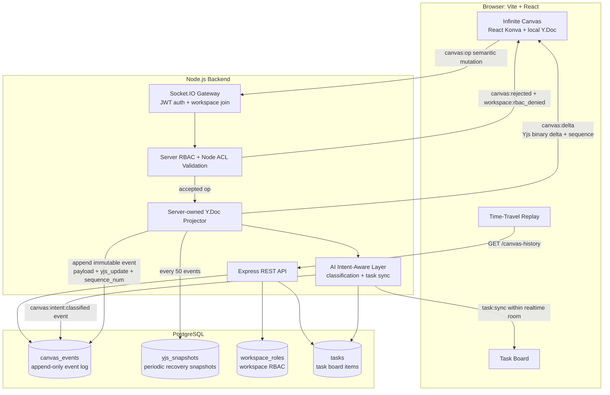
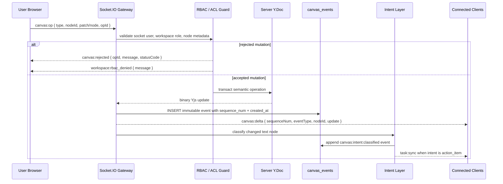

# LIGMA Comprehensive Documentation

## Executive Architecture Diagram



Live Render module: `https://ligma-client.onrender.com`

LIGMA, short for Let's Integrate Groups, Manage Anything, is a real-time collaborative workspace that connects ideation on an infinite canvas with execution on a task board. It uses a React Konva canvas, Socket.IO realtime transport, Yjs CRDT updates, an append-only PostgreSQL event log, server-side RBAC, and a local intent classifier that turns action-oriented canvas text into task-board cards.

The central architectural rule is that clients do not broadcast trusted full canvas state. A browser emits semantic operations such as `node:create`, `node:update`, `node:delete`, `node:lock`, `node:unlock`, and `node:permission:update`. The server authenticates the socket, validates workspace role and node ACL, applies the operation to the authoritative Yjs document, stores the mutation as an immutable event, then broadcasts only the resulting Yjs delta.

### Data Flow: Mutation To Immutable Event



## Deep Dive: Conflict Resolution Strategy

LIGMA chooses CRDTs over Operational Transformation. OT is a good fit for centralized text editors that transform concurrent edits against one ordered operation stream, but LIGMA's canvas is an object graph: notes, text boxes, shapes, arrows, drawings, locks, permissions, and metadata. A CRDT lets each client apply the same binary deltas and converge without maintaining pairwise transform functions for every canvas operation.

The CRDT layer is Yjs. Both the client and server maintain a `Y.Doc` with a `nodes` map for canvas element metadata and a `nodeTexts` map whose values are `Y.Text` instances for note/text bodies. The server-owned document is authoritative: accepted semantic operations are applied inside `doc.transact(...)`, converted into Yjs binary updates, persisted in `canvas_events.yjs_update`, and emitted as `canvas:delta` events. Clients apply those deltas with `Y.applyUpdate(...)`, so every connected browser reaches the same state after it receives the same sequence of accepted deltas.

For two users typing in the same text node simultaneously, LIGMA does not use "last write wins." The client converts textarea edits into `node:text:delta` operations containing an index, delete count, and inserted string. The server applies those deltas to the node's `Y.Text` value, so concurrent inserts/deletes are represented as CRDT text operations rather than whole-string replacement patches. If Alice and Bob both type into the same note, both sets of character operations are retained and merged by Yjs; every client receives the same binary Yjs updates and renders identical merged text.

Canvas efficiency comes from sending deltas instead of full state. Normal collaboration emits `canvas:delta` with `sequenceNum`, `eventType`, `nodeId`, and the binary Yjs `update`. Full snapshots are reserved for initial sync, empty missed-event windows, or semantic-only recovery fallback. This keeps routine drag, resize, drawing, and text edits proportional to the mutation rather than proportional to the whole canvas.

## Security & RBAC Enforcement

RBAC is enforced on the Node.js server, not only in the UI. The browser uses `readOnly` and local checks to improve UX, but raw Socket.IO or curl attempts still pass through `server/src/ws/gateway.js`, `server/src/ws/canvas-sync.js`, `server/src/middleware/auth.js`, and `server/src/middleware/rbac.js`.

Socket connections must provide a valid JWT and `workspaceId` in the Socket.IO auth payload. The gateway rejects sockets that are unauthenticated or not members of the workspace. After connection, every mutating `canvas:op` is validated again before it is applied to the server Y.Doc.

Workspace roles are stored in `workspace_roles`:

- `viewer`: can read workspace state, tasks, events, and replay history, but cannot mutate canvas or tasks.
- `contributor`: can create nodes and edit/delete their own unlocked nodes. Contributors can edit another member's node only if that node explicitly lists them in its editor ACL.
- `lead`: can mutate workspace canvas state, lock and unlock nodes, update node permissions, invite users, and change workspace roles.

Node-level ACLs live on individual canvas elements under `node.metadata`. The important fields are:

- `authorId` / `ownerId`: used to determine contributor ownership.
- `lockedBy`: when present, contributors are blocked from editing the node.
- `permissions.editors`: an explicit per-node allow list for contributor edits.

Server validation happens in `assertCanMutate(...)`. It loads the user's role with `getUserWorkspaceRole(...)`, rejects viewers with HTTP-style status `403`, allows leads, allows contributors to create, and for updates/deletes checks node existence, lock status, ownership, and explicit editor permissions. Lead-only operations are enforced separately for `node:lock`, `node:unlock`, and `node:permission:update`.

If a viewer sends a raw Socket.IO edit such as `canvas:op { type: "node:update", ... }`, the server does not append an event and does not broadcast a delta. It emits:

```json
{
  "event": "canvas:rejected",
  "payload": {
    "opId": "client-op-id",
    "message": "View-only access: you can't edit this workspace.",
    "statusCode": 403
  }
}
```

The server also emits `workspace:rbac_denied` with the same message so the client can show a toast. REST task routes use the same role middleware and node permission checks, so task mutations linked to protected canvas nodes cannot bypass canvas ACL through curl.

## AI Intent-Aware Layer

The intent layer runs locally in `server/src/services/intent.service.js`; it does not depend on paid APIs. It classifies text-bearing canvas nodes into four categories:

- `action_item`: imperative or task-like text, including words such as `todo`, `follow up`, `assign`, `fix`, `build`, `send`, `review`, `implement`, `deadline`, `urgent`, and checklist syntax.
- `decision`: decision-oriented language such as `decision`, `decided`, `agreed`, `approved`, `we will`, `chosen`, or `final`.
- `open_question`: question marks or question phrasing such as `who`, `what`, `when`, `where`, `why`, `how`, `should`, or `could`.
- `reference`: links, docs, FYI/background text, or neutral context without stronger action, decision, or question signals.

Classification is triggered after accepted `node:create` and `node:update` operations. The server calls `maybeClassifyNode(...)`, classifies the node text, writes the classification into `node.metadata.intent`, appends a `canvas:intent:classified` event, and broadcasts another `canvas:delta` so all clients see the same metadata. Sticky notes intentionally default toward `action_item` unless they are clearly a question, decision, link, or explicit reference, because sticky notes usually represent work to be done.

Task-board integration happens in the same realtime path. If the classified intent is `action_item`, the server calls `taskService.upsertTaskByNodeId(...)` using the canvas node id as `source_node_id`. It then emits `task:sync` to the workspace room. The client listens for `task:sync` and refreshes the task board, so an action item written on the canvas should populate the board within the normal socket/database round trip, comfortably inside the 3 second judging requirement on an awake Render service.

## Event Sourcing & Resilience

`canvas_events` is the source of truth for canvas history. Every accepted mutation is stored as an immutable row with:

- `workspace_id`: workspace partition.
- `user_id`: actor that produced the mutation or classification.
- `event_type`: semantic event name, for example `canvas:node:update`.
- `node_id`: affected canvas node.
- `payload`: JSONB semantic payload.
- `yjs_update`: binary Yjs delta when available.
- `sequence_num`: monotonic per-workspace ordering key.
- `created_at`: database timestamp.

`eventService.appendEvent(...)` opens a transaction, locks the workspace row with `SELECT ... FOR UPDATE`, computes the next `sequence_num`, inserts the event, and commits. The `(workspace_id, sequence_num)` unique constraint guarantees a stable ordered stream per workspace.

Recovery uses both snapshots and replay. When a room is loaded, the server starts from the latest `yjs_snapshots` row, then replays `canvas_events` after that snapshot. While clients are connected, every 50 accepted events the server writes a fresh Yjs snapshot to reduce cold-start replay cost.

When a client reconnects, it sends `canvas:hello { lastSequenceNum }`. If the sequence is `0`, the server sends a full Yjs snapshot. If the sequence is positive, the server queries `getEventsSince(workspaceId, lastSequenceNum)` and emits missed `canvas:delta` messages in order. If the missed window contains semantic-only events that cannot be safely replayed as independent deltas, the server falls back to the authoritative snapshot to avoid drift.

## Technical Stack & Deployment

Frontend:

- Vite + React 18 for the SPA.
- React Router for auth, workspace, project, and task-board pages.
- React Konva + Konva for infinite canvas rendering.
- Yjs for CRDT state convergence.
- Socket.IO client for realtime collaboration, presence, cursors, deltas, rejection events, and task sync.

Backend:

- Node.js 20, Express, and Socket.IO.
- PostgreSQL with `pg` and SQL migrations.
- JWT authentication with access tokens and HTTP-only refresh cookie support.
- Bcrypt for password hashing.
- Yjs for authoritative server-side canvas projection.
- Node's built-in test runner for server unit tests.

Deployment:

- Render static site: `ligma-client` at `https://ligma-client.onrender.com`.
- Render web service: `ligma-server` at `https://ligma-server.onrender.com`.
- Render Postgres database: `ligma-db`.
- Server health check: `GET https://ligma-server.onrender.com/api/health`.

The included `render.yaml` configures the static client, Node server, and Postgres database. Server startup runs `npm run migrate && npm start`, so schema migrations apply before the app boots. Render free services can sleep after inactivity; the canvas client shows a wake/reconnect state and Socket.IO retries automatically.

## API Reference

All protected REST endpoints return structured JSON and require `Authorization: Bearer <accessToken>` unless noted.

Auth endpoints:

- `POST /api/auth/register` with `{ "username": "...", "password": "...", "displayName": "..." }` returns `{ "accessToken": "...", "user": { ... } }`.
- `POST /api/auth/login` with `{ "username": "...", "password": "..." }` returns `{ "accessToken": "...", "user": { ... } }`.
- `POST /api/auth/refresh` returns `{ "accessToken": "...", "user": { ... } }` from the refresh cookie.
- `POST /api/auth/logout` returns `{ "ok": true }`.
- `GET /api/auth/me` returns `{ "user": { ... } }`.

Workspace and member endpoints:

- `POST /api/workspaces` returns `{ "workspace": { ... } }`.
- `GET /api/workspaces` returns `{ "workspaces": [ ... ] }`.
- `GET /api/workspaces/:id` returns workspace details and members.
- `POST /api/workspaces/:id/invite` is lead-only and returns `{ "member": { ... } }`.
- `POST /api/workspaces/:id/invite-link` is lead-only and returns `{ "token": "...", "inviteUrl": "...", "role": "..." }`.
- `POST /api/workspaces/invite-links/accept` returns `{ "accepted": { ... } }`.
- `PATCH /api/workspaces/:id/roles/:userId` is lead-only and returns `{ "role": { ... } }`.

Task and event endpoints:

- `GET /api/workspaces/all/tasks` returns `{ "tasks": [ ... ] }` for all workspaces visible to the user.
- `GET /api/workspaces/:id/tasks` returns `{ "tasks": [ ... ] }`.
- `POST /api/workspaces/:id/tasks` returns `{ "task": { ... } }`.
- `PUT /api/workspaces/:id/tasks/node/:nodeId` upserts a node-linked task and returns `{ "task": { ... } }`.
- `PATCH /api/workspaces/:id/tasks/:taskId` returns `{ "task": { ... } }`.
- `DELETE /api/workspaces/:id/tasks/:taskId` returns `{ "deleted": { ... } }`.
- `GET /api/workspaces/:id/events` returns `{ "events": [ ... ] }`.
- `GET /api/workspaces/:id/canvas-history` returns `{ "minSequence": 1, "maxSequence": 42, "events": [ ... ] }`.

Realtime Socket.IO events:

- Client sends `canvas:hello { lastSequenceNum }` to request snapshot or missed-event replay.
- Client sends `canvas:op { type, nodeId, node, patch, delta, permissions, opId }` to request a mutation.
- Text edits use `type: "node:text:delta"` with `delta: { index, delete, insert }`; full `patch.text` updates are rejected so text collaboration does not fall back to last-write-wins.
- Server emits `canvas:delta { opId, sequenceNum, eventType, nodeId, update }` for accepted state changes.
- Server emits `canvas:rejected { opId, message, statusCode }` for rejected mutations.
- Server emits `workspace:rbac_denied { message }` for user-visible RBAC denial.
- Server emits `task:sync { id, title, status, sourceNodeId, ... }` when action-item extraction creates or updates a task.

## Separation Of Concerns

The codebase is split by responsibility:

```text
client/
  src/components/CanvasView.jsx        realtime canvas, Yjs client doc, Socket.IO deltas
  src/components/CanvasReplay.jsx      time-travel replay UI
  src/board/                          task board components
  src/pages/                          route-level screens
  src/net/                            API and AI client helpers
  src/styles/                         CSS modules by feature

server/
  src/index.js                        Express app, health endpoint, HTTP + WebSocket server
  src/routes/                         REST API route modules
  src/ws/gateway.js                   Socket.IO auth, workspace membership, presence
  src/ws/canvas-sync.js               canvas mutation validation, Yjs projection, event append
  src/middleware/auth.js              JWT request/socket authentication
  src/middleware/rbac.js              workspace role and node permission helpers
  src/services/event.service.js       append-only event store and snapshots
  src/services/intent.service.js      intent classification
  src/services/task.service.js        task CRUD and node-linked upsert
  src/services/canvas-event-projector.js semantic event replay into Yjs
  src/db/migrations/                  PostgreSQL schema migrations
```

## Bonus Feature: Time-Travel Replay

Time-travel replay is built directly on the event-sourced architecture. The server exposes `GET /api/workspaces/:id/canvas-history`, which serializes all ordered canvas events, including their semantic payloads, timestamps, sequence numbers, and binary Yjs updates converted into JSON-safe arrays.

`client/src/components/CanvasReplay.jsx` loads that history and reconstructs the canvas at any selected sequence number. It creates a temporary `Y.Doc`, sorts events by `sequenceNum`, applies each event up to the selected point, then renders the projected nodes in a read-only Konva overlay. Events with `yjsUpdate` are applied with `Y.applyUpdate(...)`; semantic-only events use the same event projection logic as the server for create, update, delete, lock, unlock, permission changes, and intent classification.

The replay UI includes a sequence slider, step backward/forward controls, play/pause, reload, and an event label showing what happened at the active sequence. Live editing is visually separated from replay mode so reviewing history does not mutate the active canvas.

## Local Setup

1. Install dependencies:

```bash
npm install
```

2. Create a local env file:

```powershell
Copy-Item .env.example .env
```

3. Start PostgreSQL and run migrations:

```bash
docker compose up -d
npm run migrate --workspace server
```

4. Start the app:

```bash
npm run dev
```

Local URLs:

- Client: `http://localhost:5173`
- Server health: `http://localhost:3000/api/health`

## Common Commands

- `npm run dev`: run server and client dev processes.
- `npm run dev:server`: run the API only.
- `npm run dev:client`: run the Vite client only.
- `npm run build`: build the client.
- `npm run migrate --workspace server`: apply DB migrations.
- `npm run backup:event-log --workspace server`: export demo data from Postgres to `server/backups/`.
- `npm run test --workspace server`: run server unit tests.

## Demo Verification Checklist

- `GET https://ligma-server.onrender.com/api/health` returns `{ "ok": true, "service": "ligma-server", ... }`.
- Two browser sessions connected to the same workspace converge after canvas edits.
- A viewer attempting a raw `canvas:op` receives `canvas:rejected` with status `403`.
- A contributor cannot edit a locked node or another user's node without `metadata.permissions.editors`.
- Reconnect sends `canvas:hello` and recovers missed sequence numbers or an authoritative snapshot.
- Text like `Action item: follow up with design` creates or updates a task-board card within 3 seconds on an awake server.
- Time Travel can scrub from the first canvas event to the latest sequence without modifying live state.
