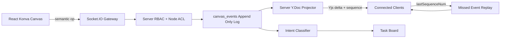
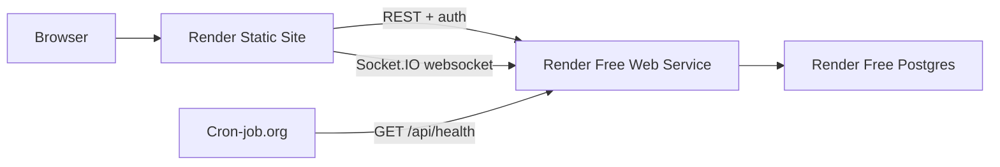

# LIGMA

Let's Integrate Groups, Manage Anything.

LIGMA is a real-time collaborative workspace that connects ideation on an infinite canvas with execution on a task board. The canvas is implemented with React Konva for rendering, Yjs for CRDT convergence, Socket.IO for authenticated realtime transport, PostgreSQL for event sourcing, and server-side RBAC for every mutation.

## Architecture



The important design choice is that clients do not submit trusted raw document state. They submit semantic operations such as `node:create`, `node:update`, `node:delete`, `node:lock`, and `node:permission:update`. The server validates workspace role and node-level ACL, appends an immutable event, applies it to the server-owned Yjs document, then broadcasts only the resulting delta.

## Constraint Strategy

- **Conflict resolution:** Yjs is the CRDT layer. All accepted operations are projected into a server-owned Y.Doc and clients converge by applying Yjs deltas.
- **Event sourcing:** `canvas_events` is the append-only source of truth. Events carry semantic payloads, node ids, sequence numbers, and optional binary Yjs updates.
- **Delta-only realtime:** Socket.IO broadcasts `canvas:delta` updates, not full canvas state, during normal collaboration.
- **Recovery:** clients reconnect with `lastSequenceNum`; the server replays only missed event deltas. Fresh clients receive a Yjs snapshot update.
- **Server-side RBAC:** viewers cannot mutate, contributors can create and edit their own unlocked nodes, and leads can lock/unlock nodes or change node permissions.
- **Intent extraction:** a local zero-paid classifier maps text nodes to `action_item`, `decision`, `open_question`, or `reference`.
- **Task sync:** action-item nodes upsert task-board entries with original author metadata and `source_node_id` links back to the canvas node.

## Repository Structure

```text
.
├─ client/                 # Vite + React frontend
│  ├─ src/components/      # React Konva canvas
│  ├─ src/pages/           # Workspace, task board, auth pages
│  └─ src/styles/          # UI and canvas styles
├─ server/                 # Express + Socket.IO backend
│  └─ src/
│     ├─ db/               # PostgreSQL pool + migrations
│     ├─ middleware/       # auth + RBAC
│     ├─ routes/           # auth/workspace/task APIs
│     ├─ services/         # event log, tasks, intent classifier
│     └─ ws/               # canvas sync gateway
├─ ai/                     # Optional FastAPI + Gemini intent HTTP API
├─ docker-compose.yml      # Local PostgreSQL
└─ render.yaml             # Render Blueprint
```

## Local Setup

1. Install dependencies:

```bash
npm install
```

2. Create your local env file:

```powershell
Copy-Item .env.example .env
```

3. Start PostgreSQL and run migrations:

```bash
docker compose up -d
npm run migrate --workspace server
```

4. Start the app:

```bash
npm run dev
```

- Client: `http://localhost:5173`
- Server health: `http://localhost:3000/api/health`

## Common Commands

- `npm run dev` - run server, client, and optional AI service (Gemini) dev processes.
- `npm run dev:server` - run the API only.
- `npm run dev:client` - run the Vite client only.
- `npm run build` - build the client.
- `npm run migrate --workspace server` - apply DB migrations.
- `npm run backup:event-log --workspace server` - export demo data from Postgres to `server/backups/`.
- `npm run test --workspace server` - run server unit tests.

## Deployment

The hackathon deployment uses Render for the static frontend, Node backend, and Postgres database on free plans:



### Render Free Blueprint

The included `render.yaml` deploys:

- `ligma-client` - Render Static Site, free
- `ligma-server` - Render Free Web Service
- `ligma-ai` - Render Free Web Service (Python / Gemini for `/api/ai/classify` proxy)
- `ligma-db` - Render Free Postgres

The server start command runs migrations before booting, so the database schema is created automatically during deploy.

Render Free Postgres expires after 30 days and does not provide production-grade backup safety. That is acceptable for short hackathon evaluation windows, but export a backup before judging.

The blueprint sets the required service URLs:

- Backend `CLIENT_URL=https://ligma-client.onrender.com`
- Backend `CLIENT_URLS=https://ligma-client.onrender.com,http://localhost:5173`
- Frontend `VITE_SERVER_URL=https://ligma-server.onrender.com`
- Frontend `VITE_SOCKET_URL=https://ligma-server.onrender.com`

If Render gives either service a different URL, update those values in the Render dashboard and redeploy the affected service.

Render build/start commands are already configured:

- Server build: `npm install`
- Server start: `npm run migrate && npm start`
- Server health check: `/api/health`
- Client build: `npm install && npm run build`
- Client publish directory: `dist`

### Demo Reliability

Render free services can sleep after inactivity. The canvas shows a "Waking up server..." state and retries Socket.IO reconnects automatically. For judging, add a free Cron-job.org job that requests `https://ligma-server.onrender.com/api/health` every 10 minutes.

Render Free Postgres expires after 30 days. Before a demo, export the event log and related workspace/task data:

```bash
DATABASE_URL="<render-postgres-external-url>" npm run backup:event-log --workspace server
```

After deployment, verify:

- `GET https://<render-backend>.onrender.com/api/health` returns `ok: true`.
- Two browser sessions connected to the same workspace converge after canvas edits.
- Reconnect resumes from missed sequence numbers.
- Text nodes classified as action items appear on the task board within 3 seconds.
