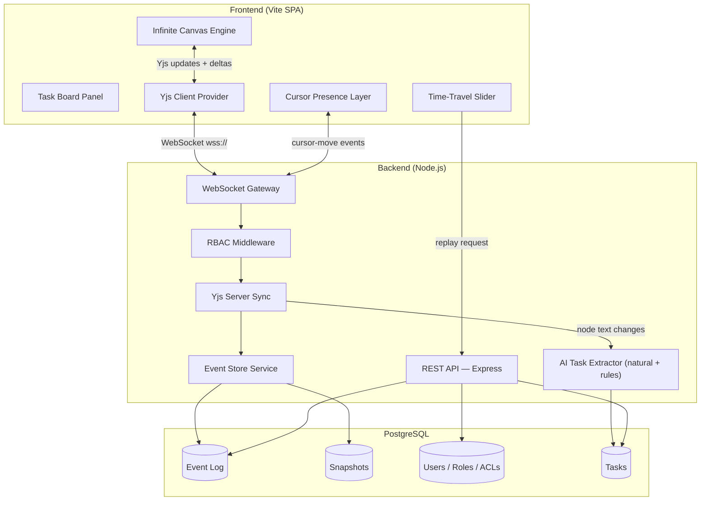
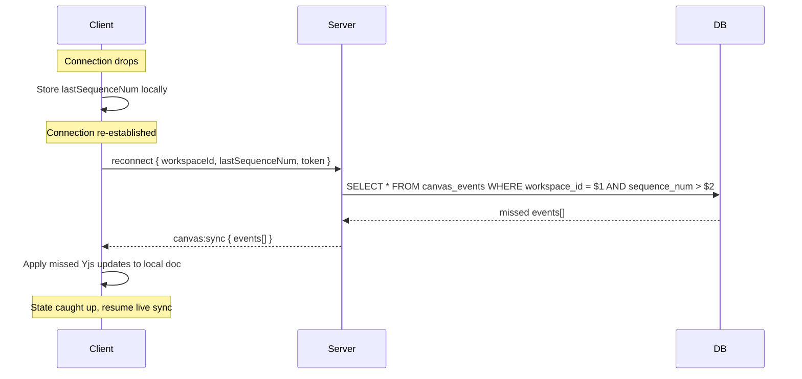

# LIGMA — Let's Integrate Groups, Manage Anything

A real-time collaborative workspace bridging ideation (infinite canvas) and execution (task board), built with CRDTs, event sourcing, RBAC, and NLP-powered AI task extraction (`natural` + rule boosters).

---

## High-Level Architecture



---

## User Review Required

> [!NOTE]
> **AI Layer — DECIDED** — Using **`natural` (Naive Bayes classifier) + rule-based confidence boosters** for Intent-Aware Task Extraction. This gives ~85% accuracy with only ~2MB overhead, zero paid APIs, and a modular architecture that can swap in Transformers.js later if needed.

> [!IMPORTANT]
> **Frontend Framework** — I plan to use **Vite (vanilla JS + modules)** for the frontend to keep things lean and avoid heavy framework overhead. The infinite canvas will be built with a custom HTML5 Canvas engine with DOM-overlaid sticky notes. No React/Vue dependency. **Please confirm or request React/Vue.**

> [!WARNING]
> **PostgreSQL Setup** — You'll need a running PostgreSQL instance locally for development. I'll provide a Docker Compose file for convenience. For Render deployment, you'll create a managed PostgreSQL addon.

---

## Proposed Changes

### Phase 1: Project Scaffolding & Configuration

#### [NEW] [package.json](file:///d:/Projects/LIGMA/package.json)
Root `package.json` with workspaces for `server/` and `client/`. Scripts for `dev`, `build`, `start`.

#### [NEW] [docker-compose.yml](file:///d:/Projects/LIGMA/docker-compose.yml)
PostgreSQL 16 + pgAdmin for local development.

#### [NEW] [.env.example](file:///d:/Projects/LIGMA/.env.example)
Template for `DATABASE_URL`, `JWT_SECRET`, `PORT`, `WS_PORT`.

#### [NEW] [render.yaml](file:///d:/Projects/LIGMA/render.yaml)
Render Blueprint for automated deployment (web service + PostgreSQL addon).

---

### Phase 2: Database Layer (PostgreSQL + Event Sourcing)

#### [NEW] [server/src/db/pool.js](file:///d:/Projects/LIGMA/server/src/db/pool.js)
PostgreSQL connection pool using `pg` library.

#### [NEW] [server/src/db/migrations/001_init.sql](file:///d:/Projects/LIGMA/server/src/db/migrations/001_init.sql)
Core schema:

```sql
-- Users & Auth
CREATE TABLE users (
  id UUID PRIMARY KEY DEFAULT gen_random_uuid(),
  username VARCHAR(50) UNIQUE NOT NULL,
  password_hash TEXT NOT NULL,
  display_name VARCHAR(100),
  color VARCHAR(7) DEFAULT '#6366f1',
  created_at TIMESTAMPTZ DEFAULT NOW()
);

-- Workspaces (canvas rooms)
CREATE TABLE workspaces (
  id UUID PRIMARY KEY DEFAULT gen_random_uuid(),
  name VARCHAR(200) NOT NULL,
  created_by UUID REFERENCES users(id),
  created_at TIMESTAMPTZ DEFAULT NOW()
);

-- RBAC: Node-Level ACLs
CREATE TABLE workspace_roles (
  id UUID PRIMARY KEY DEFAULT gen_random_uuid(),
  workspace_id UUID REFERENCES workspaces(id) ON DELETE CASCADE,
  user_id UUID REFERENCES users(id) ON DELETE CASCADE,
  role VARCHAR(20) CHECK (role IN ('lead', 'contributor', 'viewer')) NOT NULL,
  UNIQUE(workspace_id, user_id)
);

-- Immutable Event Log (Event Sourcing)
CREATE TABLE canvas_events (
  id BIGSERIAL PRIMARY KEY,
  workspace_id UUID REFERENCES workspaces(id) ON DELETE CASCADE,
  user_id UUID REFERENCES users(id),
  event_type VARCHAR(50) NOT NULL,       -- 'node:create', 'node:update', 'node:delete', 'node:move', 'yjs:update'
  node_id UUID,
  payload JSONB NOT NULL,                -- event-specific data
  yjs_update BYTEA,                      -- binary Yjs update (for CRDT events)
  sequence_num BIGINT NOT NULL,          -- per-workspace monotonic sequence
  created_at TIMESTAMPTZ DEFAULT NOW()
);
CREATE INDEX idx_events_workspace_seq ON canvas_events(workspace_id, sequence_num);

-- Yjs Document Snapshots
CREATE TABLE yjs_snapshots (
  id BIGSERIAL PRIMARY KEY,
  workspace_id UUID REFERENCES workspaces(id) ON DELETE CASCADE,
  snapshot BYTEA NOT NULL,
  last_sequence_num BIGINT NOT NULL,
  created_at TIMESTAMPTZ DEFAULT NOW()
);

-- Tasks (extracted from canvas)
CREATE TABLE tasks (
  id UUID PRIMARY KEY DEFAULT gen_random_uuid(),
  workspace_id UUID REFERENCES workspaces(id) ON DELETE CASCADE,
  source_node_id UUID NOT NULL,          -- link back to canvas node
  title TEXT NOT NULL,
  intent VARCHAR(30) CHECK (intent IN ('action_item', 'decision', 'question', 'reference')),
  status VARCHAR(20) DEFAULT 'todo' CHECK (status IN ('todo', 'in_progress', 'done')),
  assignee_id UUID REFERENCES users(id),
  created_at TIMESTAMPTZ DEFAULT NOW(),
  updated_at TIMESTAMPTZ DEFAULT NOW()
);
```

#### [NEW] [server/src/db/migrations/migrate.js](file:///d:/Projects/LIGMA/server/src/db/migrations/migrate.js)
Simple migration runner that executes SQL files in order.

---

### Phase 3: Backend Services (Separation of Concerns)

```
server/src/
├── index.js              # Entry point — HTTP + WS server
├── config.js             # Environment config
├── middleware/
│   ├── auth.js           # JWT verification middleware
│   └── rbac.js           # Role-based access control middleware
├── routes/
│   ├── auth.routes.js    # POST /api/auth/register, /api/auth/login
│   ├── workspace.routes.js  # CRUD workspaces, invite users, assign roles
│   └── task.routes.js    # GET/PATCH tasks
├── services/
│   ├── auth.service.js   # Password hashing (bcrypt), JWT signing
│   ├── workspace.service.js # Workspace CRUD, role management
│   ├── event.service.js  # Append events, fetch events from sequence, snapshots
│   ├── task.service.js   # Task CRUD
│   └── ai.service.js     # NLP intent extraction (natural + rule boosters)
├── ws/
│   ├── gateway.js        # WebSocket server setup, auth handshake
│   ├── handlers.js       # Message routing (canvas mutations, cursor, presence)
│   └── yjs-sync.js       # Yjs document management, update broadcasting
└── db/
    ├── pool.js
    └── migrations/
```

#### [NEW] [server/src/middleware/auth.js](file:///d:/Projects/LIGMA/server/src/middleware/auth.js)
- JWT token verification for both HTTP (header) and WebSocket (query param / first message)
- Extracts `userId` and attaches to request/socket context

#### [NEW] [server/src/middleware/rbac.js](file:///d:/Projects/LIGMA/server/src/middleware/rbac.js)
- **Server-side RBAC enforcement** at the node level
- Permission matrix:
  | Action | Lead | Contributor | Viewer |
  |--------|------|-------------|--------|
  | Create nodes | ✅ | ✅ | ❌ |
  | Edit own nodes | ✅ | ✅ | ❌ |
  | Edit others' nodes | ✅ | ❌ | ❌ |
  | Delete any node | ✅ | ❌ | ❌ |
  | Delete own node | ✅ | ✅ | ❌ |
  | Move nodes | ✅ | ✅ | ❌ |
  | View canvas | ✅ | ✅ | ✅ |
  | Manage roles | ✅ | ❌ | ❌ |
- Every WebSocket mutation validates `authToken` + `nodeId` + user's role before applying

#### [NEW] [server/src/services/event.service.js](file:///d:/Projects/LIGMA/server/src/services/event.service.js)
- `appendEvent(workspaceId, userId, eventType, nodeId, payload, yjsUpdate)` — Appends to `canvas_events`, returns `sequence_num`
- `getEventsSince(workspaceId, sinceSequence)` — For reconnection replay
- `createSnapshot(workspaceId, doc)` — Serializes Y.Doc, stores in `yjs_snapshots`
- `getLatestSnapshot(workspaceId)` — For initial document hydration
- `getAllEvents(workspaceId)` — For time-travel replay

#### [NEW] [server/src/services/ai.service.js](file:///d:/Projects/LIGMA/server/src/services/ai.service.js)
**Hybrid NLP Intent Extraction — `natural` (Bayesian Classifier) + Rule Boosters:**

Pipeline architecture:
```
Input Text
  │
  ├─→ natural.WordTokenizer → tokenize
  ├─→ natural.PorterStemmer → normalize stems
  │
  ├─→ natural.BayesClassifier.classify(text)
  │     └─→ { intent: 'action_item', rawScore: 0.72 }
  │
  ├─→ Rule-Based Confidence Boosters (parallel)
  │     ├─ Has '?' punctuation           → boost 'question' +0.25
  │     ├─ Starts with imperative verb   → boost 'action_item' +0.20
  │     ├─ Contains TODO/FIXME/HACK      → boost 'action_item' +0.30
  │     ├─ Contains URL or file path     → boost 'reference' +0.25
  │     ├─ Contains 'decided'/'agreed'   → boost 'decision' +0.25
  │     └─ Starts with 'let\'s go with'  → boost 'decision' +0.20
  │
  ├─→ Merge: weightedScore = bayesScore * 0.6 + boosterScore * 0.4
  │
  └─→ Output: { intent, confidence, extractedTitle }
```

**Pre-trained Classifier:**
- Ships with `server/src/services/ai-training-data.json` (~50KB)
- ~100 labeled examples per intent category (400 total)
- Categories: `action_item`, `decision`, `question`, `reference`
- Classifier serialized to JSON on first boot, loaded from cache on restart
- Can be retrained with user corrections via `POST /api/ai/retrain`

**Intent categories with training examples:**
| Intent | Example Texts | Rule Boosters |
|--------|--------------|---------------|
| `action_item` | "Fix the login bug", "TODO: update docs", "We need to refactor the auth" | Imperative verbs, TODO/FIXME markers, "need to"/"should"/"must" |
| `decision` | "Decided: We'll use PostgreSQL", "Let's go with option B", "Agreed on the API schema" | "decided"/"agreed"/"let's go with"/"final" |
| `question` | "Should we use Redis?", "How does auth work?", "What's the deadline?" | `?` punctuation, interrogative starters (how/what/why/when/should we/can we) |
| `reference` | "See https://docs.yjs.dev", "Refer to the API spec", "docs: architecture.md" | URL regex, file path patterns, "see"/"refer to"/"docs:" |

- Returns `{ intent, confidence, extractedTitle }` for each node text
- Confidence threshold (0.6) to avoid false positives
- Triggered on `node:create` and `node:update` events
- **Dependency**: `natural` npm package (~2MB, zero native deps)

---

### Phase 4: WebSocket Layer (Real-Time Engine)

#### [NEW] [server/src/ws/gateway.js](file:///d:/Projects/LIGMA/server/src/ws/gateway.js)
- Socket.IO server attached to the HTTP server
- **Auth handshake**: Token extracted from `socket.handshake.auth.token`, verified via `auth.middleware`
- Room management: `socket.join(workspaceId)`
- Connection tracking for presence/cursor data

#### [NEW] [server/src/ws/handlers.js](file:///d:/Projects/LIGMA/server/src/ws/handlers.js)
Message protocol (all messages include `authToken` and `nodeId` where applicable):

| Event | Direction | Payload | Description |
|-------|-----------|---------|-------------|
| `canvas:node:create` | C→S | `{ nodeId, type, x, y, content, style }` | Create sticky/shape/text |
| `canvas:node:update` | C→S | `{ nodeId, delta }` | Update node content (Yjs delta) |
| `canvas:node:move` | C→S | `{ nodeId, x, y }` | Reposition node |
| `canvas:node:delete` | C→S | `{ nodeId }` | Delete node |
| `canvas:sync` | S→C | `{ events[] }` | Initial state + missed events on reconnect |
| `canvas:delta` | S→C | `{ event }` | Broadcast single delta to room |
| `cursor:move` | C→S→C | `{ x, y, userId, color, name }` | Cursor presence |
| `presence:join` | S→C | `{ userId, name, color }` | User joined workspace |
| `presence:leave` | S→C | `{ userId }` | User left workspace |

#### [NEW] [server/src/ws/yjs-sync.js](file:///d:/Projects/LIGMA/server/src/ws/yjs-sync.js)
- Maintains in-memory `Y.Doc` per active workspace
- On `yjs:update` → applies to server doc → appends to event store → broadcasts delta
- Periodic snapshotting (every 50 updates or 60s)
- Hydration: Load latest snapshot + replay subsequent events

---

### Phase 5: Frontend — Infinite Canvas

```
client/
├── index.html
├── src/
│   ├── main.js                  # App bootstrap, router
│   ├── styles/
│   │   ├── index.css            # Design system tokens, base styles
│   │   ├── canvas.css           # Canvas-specific styles
│   │   ├── board.css            # Task board styles
│   │   └── auth.css             # Login/register styles
│   ├── canvas/
│   │   ├── CanvasEngine.js      # Core: pan, zoom, coordinate transforms
│   │   ├── CanvasRenderer.js    # Renders grid, connections, selection
│   │   ├── NodeManager.js       # CRUD for canvas nodes (sticky, text, shape)
│   │   ├── CursorLayer.js       # Remote cursor rendering
│   │   └── TimeTravel.js        # Timeline slider, event replay
│   ├── board/
│   │   ├── TaskBoard.js         # Kanban board component
│   │   └── TaskCard.js          # Individual task card
│   ├── auth/
│   │   └── AuthUI.js            # Login/register forms
│   ├── net/
│   │   ├── socket.js            # Socket.IO client, reconnection logic
│   │   ├── api.js               # REST API client (fetch wrapper)
│   │   └── yjs-provider.js      # Yjs <-> Socket.IO bridge
│   └── utils/
│       ├── state.js             # Simple reactive state store
│       └── helpers.js           # Debounce, throttle, UUID, etc.
├── vite.config.js
└── package.json
```

#### [NEW] [client/src/canvas/CanvasEngine.js](file:///d:/Projects/LIGMA/client/src/canvas/CanvasEngine.js)
- **Camera system**: `{ x, y, scale }` with smooth interpolation
- **Pan**: Middle-click drag or Space+drag, touch-2-finger drag
- **Zoom**: Scroll wheel / pinch, zooms toward cursor position
- **Coordinate transforms**: `screenToWorld(x, y)`, `worldToScreen(x, y)`
- **Viewport culling**: Only render/update nodes within visible bounds
- **Grid rendering**: Subtle dot grid that scales with zoom

#### [NEW] [client/src/canvas/NodeManager.js](file:///d:/Projects/LIGMA/client/src/canvas/NodeManager.js)
- Nodes are **DOM elements** overlaid on the canvas (for `contenteditable` text editing)
- Node types: `sticky` (colored card), `text` (plain text), `shape` (rectangle/circle/diamond)
- Drag-to-move with smooth animation
- Double-click to edit text content
- Color picker for sticky notes
- Each node stores: `{ id, type, x, y, width, height, content, color, createdBy }`

#### [NEW] [client/src/canvas/CursorLayer.js](file:///d:/Projects/LIGMA/client/src/canvas/CursorLayer.js)
- Absolute-positioned cursor elements overlaid on canvas
- Smooth CSS transition movement (`transform: translate()`)
- Throttled emission (30fps) via `requestAnimationFrame`
- Shows user name + colored dot
- Fades out after 5s of inactivity

#### [NEW] [client/src/canvas/TimeTravel.js](file:///d:/Projects/LIGMA/client/src/canvas/TimeTravel.js)
- Slider component at bottom of canvas
- Fetches full event log from REST API
- Replays events incrementally onto a temporary `Y.Doc`
- Read-only mode during replay
- Shows event metadata (who, when, what) at each point

---

### Phase 6: Task Board & AI Integration

#### [NEW] [client/src/board/TaskBoard.js](file:///d:/Projects/LIGMA/client/src/board/TaskBoard.js)
- Three-column Kanban: `TODO` | `In Progress` | `Done`
- Drag-and-drop between columns
- Each card shows intent badge (🎯 Action, ✅ Decision, ❓ Question, 📎 Reference)
- **"Jump to Canvas" button**: Scrolls/zooms the canvas to the source node
- Real-time updates via WebSocket

#### Task-Canvas Linking
- Every task stores `source_node_id`
- Clicking "Jump to Canvas" computes the node's world coordinates and animates the camera to center it with a highlight pulse animation
- Canvas nodes that have linked tasks show a small task badge

---

### Phase 7: Auth & RBAC UI

#### [NEW] [client/src/auth/AuthUI.js](file:///d:/Projects/LIGMA/client/src/auth/AuthUI.js)
- Login/Register forms with glassmorphism design
- JWT stored in memory (not localStorage for security), with refresh via httpOnly cookie
- Auto-redirect on token expiry

#### RBAC UI Elements
- Members sidebar panel in workspace view
- Role badges (Lead 👑, Contributor ✏️, Viewer 👁️)
- Lead can invite users and change roles via dropdown
- UI disables create/edit controls for Viewers (server still enforces)

---

### Phase 8: Graceful Recovery & Reconnection

#### Reconnection Flow


- Client persists `lastSequenceNum` in `sessionStorage`
- Socket.IO built-in reconnection with exponential backoff
- Server replays only missed events, not full state

---

## Design Aesthetic

The UI will feature:
- **Dark mode** as default with deep slate backgrounds (`#0f172a`, `#1e293b`)
- **Vibrant accent palette**: Indigo (`#6366f1`), Violet (`#8b5cf6`), Cyan (`#06b6d4`), Amber (`#f59e0b`)
- **Glassmorphism** panels: `backdrop-filter: blur(16px)` with semi-transparent backgrounds
- **Smooth micro-animations**: Node creation with scale-in, task extraction with slide-from-canvas
- **Google Fonts**: Inter for UI, JetBrains Mono for code/badges
- **Canvas grid**: Subtle dot pattern that breathes with zoom level
- **Cursor presence**: Smooth animated cursors with name labels and colored trails

---

## Open Questions

> [!NOTE]
> ~~**1. AI Layer** — RESOLVED: Using `natural` + rule boosters hybrid approach.~~

> [!NOTE]
> **2. Authentication Persistence** — Should we use httpOnly cookies for JWT refresh tokens (more secure, requires CORS config) or keep it simple with localStorage (less secure but simpler for a demo)?

---

## Verification Plan

### Automated Tests
1. **Database**: Run migration, verify schema with `\dt` and `\d+ table_name`
2. **Event Sourcing**: Insert events → fetch since sequence → verify correctness
3. **RBAC**: Test all permission combinations (lead/contributor/viewer × create/edit/delete/move)
4. **AI Extraction**: Run test suite of 30+ sample texts against expected intents
5. **Reconnection**: Simulate disconnect → inject events → reconnect → verify state sync
6. **WebSocket Auth**: Attempt mutation without token → verify rejection

### Browser Testing
1. **Multi-user Canvas**: Open 2 browser tabs, verify real-time sync of node creation/editing
2. **Cursor Presence**: Verify remote cursors appear with correct names/colors
3. **Task Extraction**: Create sticky with action text → verify task appears in board
4. **Task-Canvas Link**: Click task → verify canvas pans to source node
5. **Time Travel**: Use slider → verify canvas state at arbitrary points
6. **RBAC UI**: Login as Viewer → verify edit controls are disabled
7. **Reconnection**: Kill WebSocket → resume → verify missed events applied

### Render Deployment
1. Push to GitHub → Render auto-deploys via `render.yaml`
2. Verify WebSocket `wss://` connectivity
3. Verify PostgreSQL addon connectivity
4. Test with 3+ concurrent users
