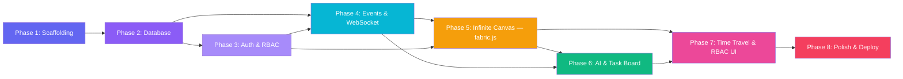

# LIGMA — Implementation Plan

**Let's Integrate Groups, Manage Anything**
A real-time collaborative workspace bridging ideation (infinite canvas) and execution (task board).

---

## Overview

This plan translates the [approved architecture](file:///C:/Users/DC/.gemini/antigravity/brain/420c2609-9b4f-4196-9211-52b81e3f6527/implementation_plan.md) into a sequenced build-out. Each phase produces a testable artifact. Phases are ordered by dependency — later phases build on earlier ones.

### Tech Stack Summary

| Layer      | Technology                                               |
| ---------- | -------------------------------------------------------- |
| Frontend   | Vite + React, **tldraw** (open-source canvas), Yjs       |
| Backend    | Node.js, Express, Socket.IO, Yjs server                  |
| Database   | PostgreSQL 16 (Docker for dev, Render addon for prod)    |
| AI/NLP     | `compromise` + rule-based boosters                       |
| Auth       | JWT access tokens (in-memory) + httpOnly refresh cookies |
| CRDT       | Yjs for conflict-free real-time text/state sync          |
| Deployment | Render (via `render.yaml` Blueprint)                     |

### Current State

- `docker-compose.yml` — PostgreSQL 16 container ✅
- `.env.example` — Environment template ✅
- `server/` — **Empty**, needs full implementation
- `client/` — **Empty**, needs full implementation

---

## Phase 1 — Project Scaffolding & Configuration

> [!NOTE]
> **Goal**: Monorepo structure, dev tooling, all config files. Both `npm run dev` (server) and `npm run dev` (client) start without errors.

### Task 1.1 — Root Monorepo Setup

- [ ] Create root `package.json` with npm workspaces: `["server", "client"]`
- [ ] Add root scripts: `dev`, `dev:server`, `dev:client`, `build`, `start`
- [ ] Add `.gitignore` (node_modules, .env, dist, pgdata)

**File**: [package.json](file:///d:/Projects/LIGMA/package.json)

### Task 1.2 — Server Package Init

- [ ] Create `server/package.json` with dependencies:
  - `express`, `cors`, `cookie-parser`, `dotenv`
  - `pg` (PostgreSQL driver)
  - `socket.io`
  - `yjs`, `y-protocols`
  - `jsonwebtoken`, `bcrypt`
  - `natural` (NLP)
  - `uuid`
- [ ] Dev dependencies: `nodemon`
- [ ] Add scripts: `dev` (nodemon), `start`, `migrate`
- [ ] Create `server/src/index.js` — Minimal Express + Socket.IO startup (health check at `GET /api/health`)
- [ ] Create `server/src/config.js` — Load and validate env vars (`DATABASE_URL`, `JWT_SECRET`, `PORT`, `CLIENT_URL`)

**Files**:

- [server/package.json](file:///d:/Projects/LIGMA/server/package.json)
- [server/src/index.js](file:///d:/Projects/LIGMA/server/src/index.js)
- [server/src/config.js](file:///d:/Projects/LIGMA/server/src/config.js)

### Task 1.3 — Client Package Init (Vite)

- [ ] Initialize Vite project in `client/` with React support
- [ ] Add dependencies: `react`, `react-dom`, `react-router-dom`, `tldraw`, `yjs`, `socket.io-client`
- [ ] Create minimal `index.html` with viewport meta and font imports (Inter, JetBrains Mono)
- [ ] Create `client/src/styles/index.css` — Design system tokens (CSS custom properties for colors, spacing, typography, glassmorphism mixins)
- [ ] Create `client/src/main.jsx` — React bootstrap shell
- [ ] Create `client/src/App.jsx` — Route shell for auth, workspaces, and workspace canvas pages
- [ ] Configure `vite.config.js` — Proxy `/api` and `/socket.io` to server in dev

**Files**:

- [client/package.json](file:///d:/Projects/LIGMA/client/package.json)
- [client/vite.config.js](file:///d:/Projects/LIGMA/client/vite.config.js)
- [client/index.html](file:///d:/Projects/LIGMA/client/index.html)
- [client/src/main.jsx](file:///d:/Projects/LIGMA/client/src/main.jsx)
- [client/src/App.jsx](file:///d:/Projects/LIGMA/client/src/App.jsx)
- [client/src/styles/index.css](file:///d:/Projects/LIGMA/client/src/styles/index.css)

### Task 1.4 — Docker & Deployment Config

- [ ] Update `docker-compose.yml` — Add pgAdmin service (optional, for DB inspection)
- [ ] Create `render.yaml` — Render Blueprint (web service + PostgreSQL addon)
- [ ] Update `.env.example` if any new vars are needed

**Files**:

- [docker-compose.yml](file:///d:/Projects/LIGMA/docker-compose.yml)
- [render.yaml](file:///d:/Projects/LIGMA/render.yaml)

### ✅ Phase 1 Checkpoint

- `docker compose up` starts PostgreSQL
- `npm run dev:server` starts Express on `:3000`, `GET /api/health` returns `200`
- `npm run dev:client` starts Vite on `:5173`, shows styled landing page
- Vite proxy forwards `/api/health` to server successfully

---

## Phase 2 — Database Layer (Event Sourcing Schema)

> [!NOTE]
> **Goal**: PostgreSQL schema deployed, migration runner working. Can insert/query events and users programmatically.

### Task 2.1 — Database Connection Pool

- [ ] Create `server/src/db/pool.js` — `pg.Pool` with connection from `DATABASE_URL`
- [ ] Connection health check on startup (verify connectivity, log success/failure)
- [ ] Graceful shutdown: `pool.end()` on `SIGTERM`/`SIGINT`

**File**: [server/src/db/pool.js](file:///d:/Projects/LIGMA/server/src/db/pool.js)

### Task 2.2 — Migration System

- [ ] Create `server/src/db/migrations/001_init.sql` — Full schema:
  - `users` — UUID PK, username, password_hash, display_name, color
  - `workspaces` — UUID PK, name, created_by
  - `workspace_roles` — RBAC junction table (lead/contributor/viewer)
  - `canvas_events` — Immutable event log with sequence numbers, JSONB payload, optional BYTEA Yjs update
  - `yjs_snapshots` — Binary Yjs doc snapshots with last sequence number
  - `tasks` — Extracted tasks linked to source canvas nodes
- [ ] Create `server/src/db/migrations/migrate.js` — Reads `*.sql` files in order, executes within transaction, tracks applied migrations in a `_migrations` table
- [ ] Add `npm run migrate` script to `server/package.json`

**Files**:

- [server/src/db/migrations/001_init.sql](file:///d:/Projects/LIGMA/server/src/db/migrations/001_init.sql)
- [server/src/db/migrations/migrate.js](file:///d:/Projects/LIGMA/server/src/db/migrations/migrate.js)

### ✅ Phase 2 Checkpoint

- `docker compose up` + `npm run migrate` creates all tables
- Can manually `INSERT` a user and query it back
- Event log accepts JSONB payloads with incrementing sequence numbers
- Indexes on `canvas_events(workspace_id, sequence_num)` verified

---

## Phase 3 — Authentication & Authorization

> [!NOTE]
> **Goal**: Users can register, login, and receive JWT tokens. Refresh token flow works via httpOnly cookies. RBAC middleware blocks unauthorized mutations.

### Task 3.1 — Auth Service

- [ ] Create `server/src/services/auth.service.js`:
  - `register(username, password, displayName)` — Hash with bcrypt, insert user, return user object
  - `login(username, password)` — Verify credentials, sign JWT access token (15min) + refresh token (7d)
  - `refresh(refreshToken)` — Verify refresh token, issue new access token
  - `logout()` — Clear refresh cookie

**File**: [server/src/services/auth.service.js](file:///d:/Projects/LIGMA/server/src/services/auth.service.js)

### Task 3.2 — Auth Middleware

- [ ] Create `server/src/middleware/auth.js`:
  - Extract `Bearer` token from `Authorization` header
  - Verify JWT, attach `req.user = { id, username }` to request
  - Support WebSocket auth via `socket.handshake.auth.token`

**File**: [server/src/middleware/auth.js](file:///d:/Projects/LIGMA/server/src/middleware/auth.js)

### Task 3.3 — Auth Routes

- [ ] Create `server/src/routes/auth.routes.js`:
  - `POST /api/auth/register` — Validate input, call auth service, set refresh cookie, return access token + user
  - `POST /api/auth/login` — Same flow with credential check
  - `POST /api/auth/refresh` — Read httpOnly cookie, return new access token
  - `POST /api/auth/logout` — Clear cookie
  - `GET /api/auth/me` — Return current user from token

**File**: [server/src/routes/auth.routes.js](file:///d:/Projects/LIGMA/server/src/routes/auth.routes.js)

### Task 3.4 — RBAC Middleware

- [x] Create `server/src/middleware/rbac.js`:
  - `requireRole(...roles)` — Express middleware factory, checks `workspace_roles` for user
  - `checkNodePermission(action, nodeId, userId, workspaceId)` — Node-level permission check for WebSocket mutations
  - Permission matrix as defined in architecture (lead/contributor/viewer × create/edit/delete/move)

**File**: [server/src/middleware/rbac.js](file:///d:/Projects/LIGMA/server/src/middleware/rbac.js)

### Task 3.5 — Workspace Routes

- [x] Create `server/src/services/workspace.service.js` — CRUD for workspaces, role management
- [x] Create `server/src/routes/workspace.routes.js`:
  - `POST /api/workspaces` — Create workspace (creator becomes 'lead')
  - `GET /api/workspaces` — List user's workspaces
  - `GET /api/workspaces/:id` — Get workspace details + members
  - `POST /api/workspaces/:id/invite` — Invite user with role (lead only)
  - `PATCH /api/workspaces/:id/roles/:userId` — Change role (lead only)

**Files**:

- [server/src/services/workspace.service.js](file:///d:/Projects/LIGMA/server/src/services/workspace.service.js)
- [server/src/routes/workspace.routes.js](file:///d:/Projects/LIGMA/server/src/routes/workspace.routes.js)

### Task 3.6 — Auth UI (Frontend)

- [x] Create `client/src/auth/AuthUI.js` — Login/Register forms
  - Glassmorphism card design on dark background
  - Form validation (username 3-50 chars, password 6+ chars)
  - Store access token in JS closure (not localStorage)
  - `setTimeout` auto-refresh at 14min mark
  - Redirect to workspace list on success
- [x] Create `client/src/styles/auth.css`
- [x] Create `client/src/net/api.js` — Fetch wrapper with auto `Authorization` header, auto-refresh on 401

**Files**:

- [client/src/auth/AuthUI.js](file:///d:/Projects/LIGMA/client/src/auth/AuthUI.js)
- [client/src/styles/auth.css](file:///d:/Projects/LIGMA/client/src/styles/auth.css)
- [client/src/net/api.js](file:///d:/Projects/LIGMA/client/src/net/api.js)

### ✅ Phase 3 Checkpoint

- Can register a new user, login, and receive tokens
- Access token expires at 15min, refresh via httpOnly cookie works
- Protected routes reject requests without valid token (401)
- RBAC: Workspace lead can invite users; viewer cannot create nodes (403)
- Auth UI renders with glassmorphism styling on dark background

---

## Phase 4 — Event Sourcing Service & WebSocket Gateway

> [!NOTE]
> **Goal**: WebSocket connections established. Canvas mutations persisted as events. Real-time broadcasting to room members. Reconnection replays missed events.

### Task 4.1 — Event Store Service

- [x] Create `server/src/services/event.service.js`:
  - `appendEvent(workspaceId, userId, eventType, nodeId, payload, yjsUpdate)` — Insert event, return `{ id, sequence_num }`
  - `getEventsSince(workspaceId, sinceSequence)` — For reconnection replay
  - `getAllEvents(workspaceId)` — For time-travel
  - `createSnapshot(workspaceId, yjsStateVector)` — Store binary snapshot
  - `getLatestSnapshot(workspaceId)` — For initial hydration

**File**: [server/src/services/event.service.js](file:///d:/Projects/LIGMA/server/src/services/event.service.js)

### Task 4.2 — WebSocket Gateway

- [x] Create `server/src/ws/gateway.js`:
  - Attach Socket.IO to HTTP server
  - Auth handshake: verify `socket.handshake.auth.token` via auth middleware
  - On connect: join `room:${workspaceId}`, broadcast `presence:join`
  - On disconnect: broadcast `presence:leave`, clean up tracking
  - Connection tracking map: `socketId → { userId, workspaceId, username, color }`

**File**: [server/src/ws/gateway.js](file:///d:/Projects/LIGMA/server/src/ws/gateway.js)

### Task 4.3 — WebSocket Message Handlers

- [x] Create `server/src/ws/handlers.js`:
  - Route all `canvas:*` events through RBAC check
  - `canvas:node:create` → validate → append event → broadcast `canvas:delta`
  - `canvas:node:update` → validate ownership → append → broadcast
  - `canvas:node:move` → validate → append → broadcast
  - `canvas:node:delete` → validate (lead or own node) → append → broadcast
  - `canvas:draw:stroke` → validate → append → broadcast
  - `canvas:draw:erase` → validate → append → broadcast
  - `cursor:move` → broadcast to room (no persistence)
  - `reconnect` → fetch events since `lastSequenceNum` → emit `canvas:sync`

**File**: [server/src/ws/handlers.js](file:///d:/Projects/LIGMA/server/src/ws/handlers.js)

### Task 4.4 — Yjs Server Sync

- [x] Create `server/src/ws/yjs-sync.js`:
  - In-memory `Map<workspaceId, Y.Doc>`
  - On first connection: hydrate from latest snapshot + replay subsequent events
  - On `yjs:update`: apply to server Y.Doc → append event → broadcast
  - Periodic snapshotting: every 50 updates OR 60 seconds (whichever first)
  - Cleanup: remove Y.Doc from memory when last user leaves workspace

**File**: [server/src/ws/yjs-sync.js](file:///d:/Projects/LIGMA/server/src/ws/yjs-sync.js)

### Task 4.5 — Socket.IO Client Setup

- [x] Create `client/src/net/socket.js`:
  - Connect to server with `auth: { token }` handshake
  - Auto-reconnect with exponential backoff (Socket.IO built-in)
  - On reconnect: send `lastSequenceNum` from `sessionStorage`
  - Expose `emit()` and `on()` wrappers
  - Connection state indicator (connected/reconnecting/disconnected)

**File**: [client/src/net/socket.js](file:///d:/Projects/LIGMA/client/src/net/socket.js)

### Task 4.6 — Yjs Client Provider

- [x] Create `client/src/net/yjs-provider.js`:
  - Bridge between local `Y.Doc` and Socket.IO transport
  - Send Y.Doc updates as `yjs:update` events
  - Apply incoming updates to local doc
  - Awareness protocol for cursor/presence metadata

**File**: [client/src/net/yjs-provider.js](file:///d:/Projects/LIGMA/client/src/net/yjs-provider.js)

### ✅ Phase 4 Checkpoint

- Two browser tabs connect to same workspace via WebSocket
- Events emitted from one tab appear in the other
- Server persists events to `canvas_events` table with incrementing sequence numbers
- Disconnect one tab → push events from other → reconnect first tab → missed events replayed
- Yjs snapshot created after 50 updates

---

## Phase 5 — Infinite Canvas (Core Frontend — fabric.js)

> [!NOTE]
> **Goal**: Working infinite canvas with pan, zoom, node CRUD, drawing, and **real-time multi-user collaboration via WebSockets**. This phase uses [**fabric.js v6**](https://github.com/fabricjs/fabric.js) (MIT-licensed, framework-agnostic) as the open-source canvas engine, modified to integrate with our Socket.IO + Yjs distributed backend.

> [!IMPORTANT]
> **Why fabric.js**: The instructor requires using an open-source canvas project adapted for distributed collaboration. Fabric.js is framework-agnostic (works with our vanilla JS + Vite stack), provides built-in object management (Rect, Circle, IText, Path), freehand drawing (PencilBrush), selection, drag-to-move, serialization (`toJSON()`/`loadFromJSON()`), and a viewport transform system for pan/zoom — eliminating the need to build a canvas engine from scratch. We modify it to emit all mutations over WebSocket and sync state via Yjs CRDTs.

### Task 5.1 — Fabric.js Setup & Infinite Viewport

- [ ] Install `fabric` (v6) in client: `npm install fabric`
- [ ] Create `client/src/canvas/CanvasEngine.js` — Wrapper around `fabric.Canvas`:
  - Initialize `fabric.Canvas` on a full-viewport `<canvas>` element
  - **Infinite pan**: `mouse:down` + `mouse:move` with Alt-key or middle-button drag — updates `canvas.viewportTransform` translation values
  - **Zoom to cursor**: `mouse:wheel` → `canvas.zoomToPoint(pointer, newZoom)`, clamp zoom between 0.1× and 5×
  - **Touch support**: 2-finger pinch zoom + drag pan via touch events
  - **Coordinate helpers**: `screenToWorld(sx, sy)` via `fabric.util.invertTransform()` + `fabric.util.transformPoint()`, and `worldToScreen(wx, wy)` via `canvas.viewportTransform`
  - **Animated navigation**: `animateTo(x, y, zoom)` — smoothly transitions `viewportTransform` using `fabric.util.animate()` with easeInOutCubic (used by "Jump to Canvas" from task board)
  - **Grid background**: Separate static `<canvas>` layer behind the fabric canvas, renders dot-grid pattern that updates on viewport change — spacing scales with zoom (20px at 1×, 40px at 2×)
  - **Viewport change event**: Emits custom `viewport:changed` event (used by grid, cursor layer, and culling logic)
- [ ] Create `client/src/styles/canvas.css` — Canvas container, layer stacking (grid → fabric → cursor overlay), toolbar positioning

**Files**:

- [client/src/canvas/CanvasEngine.js](file:///d:/Projects/LIGMA/client/src/canvas/CanvasEngine.js)
- [client/src/styles/canvas.css](file:///d:/Projects/LIGMA/client/src/styles/canvas.css)

### Task 5.2 — Node Manager (Sticky Notes, Text, Shapes) + WebSocket Sync

- [ ] Create `client/src/canvas/NodeManager.js` — Uses native fabric.js object types:
  - **Sticky note** → `fabric.Group` containing a `fabric.Rect` (colored background, rounded corners, drop shadow) + `fabric.IText` (editable label)
  - **Text block** → `fabric.IText` (bare editable text, no background)
  - **Shape** → `fabric.Rect`, `fabric.Circle`, or `fabric.Polygon` (diamond) with configurable fill/stroke
  - All objects assigned a unique `id` property (UUID v4) on creation + `createdBy` (current user ID)
  - Node data model: `{ id, type, x, y, width, height, content, color, createdBy }` — serialized via `obj.toJSON(['id', 'createdBy', 'nodeType'])`
  - **Double-click to create**: Fabric's `mouse:dblclick` event → create node at world-space cursor position
  - **Inline text editing**: Fabric's built-in `IText` editing mode; for rich/collaborative text, a DOM `
` overlay is positioned over the node, bound to a per-node Yjs `Y.Text` — this enables CRDT-based concurrent text editing
  - **Drag-to-move**: Built-in fabric.js object dragging (no custom code needed)
  - **Selection**: Click to select, Shift+click for multi-select (fabric.js `ActiveSelection`)
  - **Color picker**: Palette popup on right-click or toolbar; sets `fill` on the sticky's background `Rect`
  - **Visual styles**: `rx/ry` for rounded corners, `shadow` for drop shadows, `scaleX/scaleY` animation on hover via `mouse:over`/`mouse:out`
  - **WebSocket integration** (distributed sync):
    - On `object:added` → emit `canvas:node:create` with `obj.toJSON(['id', 'createdBy', 'nodeType'])` via Socket.IO
    - On `object:modified` → emit `canvas:node:update` with `{ id, ...changedProps }`
    - On `object:removed` → emit `canvas:node:delete` with `{ id }`
    - **Incoming remote events** → find object by `id`, set `obj.__remoteUpdate = true`, apply properties via `obj.set(props)` + `obj.setCoords()` + `canvas.renderAll()`, then reset flag
    - **Loop prevention**: All event listeners check `if (e.target.__remoteUpdate) return` to avoid re-broadcasting remote changes
  - **Yjs backing**: All node metadata stored in `Y.Map('nodes')` keyed by node ID — position, color, type, content synced via Yjs; structural changes (add/remove) emit through Socket.IO event pipeline for RBAC validation

**File**: [client/src/canvas/NodeManager.js](file:///d:/Projects/LIGMA/client/src/canvas/NodeManager.js)

### Task 5.3 — Drawing Layer (Fabric.js Brushes + WebSocket Sync)

- [ ] Create `client/src/canvas/DrawingLayer.js` — Uses fabric.js built-in drawing system:
  - **Pen tool**: `canvas.isDrawingMode = true` with `fabric.PencilBrush`, width 2px, color = user's assigned color
  - **Marker tool**: `fabric.PencilBrush` with width 8px, color at 50% opacity (`rgba()`)
  - **Eraser**: Custom eraser mode — on click/drag, detect intersection with existing `fabric.Path` objects via bounding-box check, collect intersecting stroke IDs, emit `canvas:draw:erase`
  - **Tool switching**: Toggling `canvas.isDrawingMode` and swapping `canvas.freeDrawingBrush` instance
  - **Stroke event flow** (distributed):
    1. Fabric fires `path:created` with the new `fabric.Path` object
    2. Assign UUID `id` to the path, simplify points via Ramer-Douglas-Peucker (reduce 500+ → ~50 points)
    3. Serialize via `path.toJSON(['id', 'createdBy'])` → emit `canvas:draw:stroke` via Socket.IO
    4. Server validates via RBAC → appends to event store → broadcasts to room
    5. Remote clients receive → `fabric.Path.fromObject(data)` → add to canvas with `__remoteUpdate = true`
  - **Yjs storage**: All stroke paths stored in `Y.Array('strokes')` as serialized JSON; on reconnect, hydrate from Yjs doc
  - **Zoom-aware**: Fabric.js handles viewport transforms automatically — all paths are in world coordinates

**File**: [client/src/canvas/DrawingLayer.js](file:///d:/Projects/LIGMA/client/src/canvas/DrawingLayer.js)

### Task 5.4 — WebSocket ↔ Fabric.js Sync Bridge

- [ ] Create `client/src/canvas/SyncBridge.js` — Central module wiring fabric.js events to WebSocket transport:
  - **Outbound** (local → server):
    - Listens to fabric canvas events: `object:added`, `object:modified`, `object:removed`, `path:created`
    - Filters out remote updates (`__remoteUpdate` flag)
    - Serializes changed object via `toJSON(['id', 'createdBy', 'nodeType'])`
    - Emits appropriate `canvas:node:*` or `canvas:draw:*` event via Socket.IO (from Phase 4's `socket.js`)
    - Throttles `object:moving` to 15fps to avoid flooding (only final `object:modified` is authoritative)
  - **Inbound** (server → local):
    - Listens to Socket.IO events: `canvas:delta`, `canvas:sync`
    - For each delta: find existing object by `id`, or create new via `fabric.util.enlivenObjects()`
    - Apply property changes with `__remoteUpdate = true` flag → `obj.set()` → `obj.setCoords()` → `canvas.renderAll()`
    - For deletes: find by `id` → `canvas.remove(obj)`
  - **Initial hydration**: On workspace join, server sends `canvas:sync` with full state → `canvas.loadFromJSON()` to restore all objects
  - **Reconnection**: On reconnect, send `lastSequenceNum` → server replays missed events → SyncBridge applies them sequentially
  - **Conflict resolution**: Yjs CRDTs handle concurrent text edits; for positional conflicts (two users dragging same node), last-write-wins with server timestamp ordering

**File**: [client/src/canvas/SyncBridge.js](file:///d:/Projects/LIGMA/client/src/canvas/SyncBridge.js)

### Task 5.5 — Canvas Toolbar

- [ ] Add toolbar to canvas view:
  - **Tools**: Select (arrow), Sticky Note, Text, Shape (dropdown: rect/circle/diamond), Pen, Marker, Eraser
  - **Actions**: Undo, Redo, Zoom In, Zoom Out, Fit to Screen, Reset View
  - Glassmorphism floating toolbar, centered horizontally at top
  - Active tool highlighted with accent color
  - Tool switching: sets `canvas.isDrawingMode` and swaps `freeDrawingBrush` for draw tools, disables drawing mode for object tools
  - Keyboard shortcuts: `V` select, `S` sticky, `T` text, `P` pen, `E` eraser, `Ctrl+Z` undo, `Ctrl+Shift+Z` redo

_Implemented within_: [CanvasEngine.js](file:///d:/Projects/LIGMA/client/src/canvas/CanvasEngine.js) and [canvas.css](file:///d:/Projects/LIGMA/client/src/styles/canvas.css)

### Task 5.6 — Cursor Presence Layer

- [ ] Create `client/src/canvas/CursorLayer.js`:
  - HTML overlay `
` positioned above the fabric canvas (via CSS `z-index`)
  - Each remote cursor: absolute-positioned element (colored dot + name label)
  - Smooth CSS transition movement (`transform: translate()`)
  - **Coordinate conversion**: Incoming world-space cursor positions transformed via `CanvasEngine.worldToScreen()` before positioning the DOM element
  - Throttled emission at 30fps via `requestAnimationFrame` — emits `cursor:move` with world-space coords via Socket.IO
  - Fade out after 5s inactivity (CSS opacity transition)
  - Removed on `presence:leave` event

**File**: [client/src/canvas/CursorLayer.js](file:///d:/Projects/LIGMA/client/src/canvas/CursorLayer.js)

### Task 5.7 — State Management & Utilities

- [ ] Create `client/src/utils/state.js` — Simple reactive store (pub/sub pattern)
  - `createStore(initialState)` → `{ getState, setState, subscribe }`
  - Used for: current tool, auth state, workspace data, connection status
- [ ] Create `client/src/utils/helpers.js` — Utility functions:
  - `debounce()`, `throttle()`, `generateId()` (UUID v4)
  - `clamp()`, `lerp()`, `distance()` — Math helpers
  - Ramer-Douglas-Peucker point simplification algorithm (for stroke optimization before sync)

**Files**:

- [client/src/utils/state.js](file:///d:/Projects/LIGMA/client/src/utils/state.js)
- [client/src/utils/helpers.js](file:///d:/Projects/LIGMA/client/src/utils/helpers.js)

### Task 5.8 — Client Routing & Page Assembly

- [ ] Update `client/src/main.js` — Simple hash-based router:
  - `#/login` → Auth UI
  - `#/workspaces` → Workspace list (create/join)
  - `#/workspace/:id` → Canvas + Task Board view
  - Auth guard: redirect to `#/login` if no token
- [ ] Create workspace list page:
  - Card grid of user's workspaces
  - "Create Workspace" button with name input modal
  - Click workspace card → navigate to canvas

_Updated file_: [client/src/main.js](file:///d:/Projects/LIGMA/client/src/main.js)

### ✅ Phase 5 Checkpoint

- Can create, move, edit, and delete sticky notes on infinite canvas (fabric.js objects)
- Pan/zoom works via mouse wheel, Alt+drag, and touch pinch
- Drawing with pen/marker works using fabric.js PencilBrush, strokes persist
- **Two browser tabs show real-time sync** — node creates/moves/edits + drawings appear in real-time via WebSocket
- **Remote cursors visible** with names and colors on HTML overlay
- Workspace list shows user's workspaces; click to enter canvas
- All canvas mutations flow through: fabric.js event → SyncBridge → Socket.IO → Server RBAC → Event Store → Broadcast → Remote SyncBridge → Remote fabric.js canvas

---

## Phase 6 — AI Task Extraction & Task Board

> [!NOTE]
> **Goal**: AI automatically extracts tasks from sticky note text. Kanban board shows extracted tasks. Tasks link back to canvas nodes.

### Task 6.1 — AI Service (NLP Pipeline)

- [ ] Create `server/src/services/ai.service.js`:
  - Use `compromise` for lightweight tokenization and phrase matching
  - Rule-based boosters: `?` → question, imperative verb → action_item, URL → reference, "decided"/"agreed" → decision
  - Hybrid scoring: `0.6 × heuristicsScore + 0.4 × boosterScore`
  - Confidence threshold: 0.6 (skip extraction if below)
  - Returns `{ intent, confidence, extractedTitle }`
  - No training-data file or retraining pipeline is needed for this phase

**File**:

- [server/src/services/ai.service.js](file:///d:/Projects/LIGMA/server/src/services/ai.service.js)

### Task 6.2 — Task Service & Routes

- [ ] Create `server/src/services/task.service.js`:
  - `extractAndSave(workspaceId, nodeId, text)` — Run AI pipeline, insert task if confidence ≥ threshold
  - `getByWorkspace(workspaceId)` — All tasks for kanban board
  - `updateStatus(taskId, status)` — Move between columns
  - `updateAssignee(taskId, assigneeId)` — Assign user
- [ ] Create `server/src/routes/task.routes.js`:
  - `GET /api/workspaces/:id/tasks` — List tasks
  - `PATCH /api/tasks/:id` — Update status/assignee
- [ ] Hook AI extraction into WebSocket handlers: trigger on `canvas:node:create` and `canvas:node:update` (debounced)

**Files**:

- [server/src/services/task.service.js](file:///d:/Projects/LIGMA/server/src/services/task.service.js)
- [server/src/routes/task.routes.js](file:///d:/Projects/LIGMA/server/src/routes/task.routes.js)

### Task 6.3 — Task Board UI

**What changed:** Vanilla JS class → React components.

- [ ] 🔴 Create `client/src/board/TaskBoard.jsx` ~~TaskBoard.js~~:
  - `useState` for tasks, `useEffect` to fetch on mount
  - Socket.IO listener for real-time task updates
  - Three-column Kanban layout
  - 🔴 Use `@dnd-kit/core` for drag-and-drop ~~native Drag API~~ (more reliable in React)
- [ ] 🔴 Create `client/src/board/TaskCard.jsx` ~~TaskCard.js~~:
  - Same card design, now a React component
  - "Jump to Canvas" calls `jumpToNode(task.source_node_id)` from canvas context
- [ ] `client/src/styles/board.css` _(No change)_
      **Files**:
- 🔴 `client/src/board/TaskBoard.jsx`
- 🔴 `client/src/board/TaskCard.jsx`
- `client/src/styles/board.css`

### Task 6.4 — Canvas ↔ Task Linking

- [ ] Canvas nodes with linked tasks show a small badge (intent icon)
- [ ] Clicking badge opens task details panel
- [ ] "Jump to Canvas" from task board: `CanvasEngine.animateTo(node.x, node.y, 1.0)` with easing + 2-second highlight pulse on the node

_Implemented across_: NodeManager.js, TaskBoard.js, CanvasEngine.js

### ✅ Phase 6 Checkpoint

- Create a sticky note with "Fix the login bug by Friday" → task auto-extracted as `action_item`
- Task appears in TODO column of kanban board
- Click "Jump to Canvas" on task → canvas pans and zooms to source node
- Drag task to "Done" column → status updates in DB
- AI correctly classifies questions (`?`), references (URLs), decisions ("decided:")

---

## Phase 7 — Time Travel & RBAC UI

> [!NOTE]
> **Goal**: Timeline slider replays canvas history. RBAC controls visible in UI with role badges and permission-gated controls.

### Task 7.1 — Time Travel Slider 🔴 CHANGED

**What changed:** Vanilla JS slider → React component. tldraw replay uses tldraw's store instead of raw Y.Doc.

- [ ] 🔴 Create `client/src/canvas/TimeTravel.jsx` ~~TimeTravel.js~~:
  - React component, renders as a panel inside the canvas view
  - Fetches event log via REST
  - 🔴 Replay applies events to a **separate tldraw store** (not a Y.Doc)
    — create a second `createTLStore()` instance, apply events to it, render read-only tldraw
  - Read-only mode: `<Tldraw store={replayStore} readOnly />`
  - Same slider/play/pause UI
    **File**: 🔴 `client/src/canvas/TimeTravel.jsx`

### Task 7.2 — RBAC UI Controls 🔴 CHANGED

**What changed:** Vanilla JS DOM manipulation → React components.

- [ ] 🟢 Create `client/src/workspace/MembersSidebar.jsx` — React component for members list
- [ ] 🟢 Create `client/src/workspace/RoleBadge.jsx` — Small role indicator component
- [ ] Same permission-gated UI logic, implemented via React conditional rendering
      **Files**:
- 🟢 `client/src/workspace/MembersSidebar.jsx`
- 🟢 `client/src/workspace/RoleBadge.jsx`

- [ ] Members sidebar panel (slide from left):
  - List of workspace members with role badges (Lead 👑, Contributor ✏️, Viewer 👁️)
  - Lead can change roles via dropdown
  - Lead can invite new users (username input + role selector)
  - Online/offline status indicator per member
- [ ] Permission-gated UI:
  - Viewers: toolbar disabled, cursor changes to "not-allowed" on canvas, nodes not draggable
  - Contributors: can't delete others' nodes (delete button hidden for those)
  - Visual indicator of current user's role in the header

_Implemented across_: main.js (sidebar), canvas modules (permission checks)

### ✅ Phase 7 Checkpoint

- Time-travel slider replays canvas history frame by frame
- Read-only mode correctly prevents mutations during replay
- Viewer role: all edit controls disabled, server rejects mutation attempts
- Lead can change a contributor to viewer → UI updates immediately
- Members sidebar shows all workspace participants with roles

---

## Phase 8 — Polish, Performance & Deployment

> [!NOTE]
> **Goal**: Production-ready application deployed to Render with WebSocket support.

### Task 8.1 — Visual Polish

### Task 8.1 — Visual Polish 🔴 MINOR CHANGE

- Micro-animations: use `framer-motion` (React-native animation library) instead of manual CSS transitions
- [ ] Loading states: skeleton loaders for workspace list, task board
- [ ] Error states: toast notifications for connection errors, permission denials
- [ ] Empty states: helpful illustrations and prompts when no nodes/tasks exist

### Task 8.2 — Performance Optimization

- [ ] Canvas viewport culling: skip rendering/updating nodes outside visible bounds
- [ ] Drawing layer: dirty-region re-rendering (clip rect to changed area)
- [ ] Throttle cursor broadcasts to 30fps
- [ ] Debounce AI extraction (500ms after last node text change)
- [ ] Event log pagination for time-travel (load in chunks of 100)
- [ ] Yjs snapshot compression for large documents

### Task 8.3 — Responsive Design

- [ ] Mobile-friendly canvas controls (touch pan/zoom)
- [ ] Responsive task board (stacked columns on mobile)
- [ ] Auth forms centered and readable on all screen sizes
- [ ] Minimum viable mobile toolbar

### Task 8.4 — Deployment to Render

- [ ] Verify `render.yaml` Blueprint:
  - Web service: `server/` with `npm start`, health check on `/api/health`
  - Static site: `client/` with `npm run build`, publish from `dist/`
  - PostgreSQL addon: `ligma-db`
  - Environment variables: `DATABASE_URL` (auto from addon), `JWT_SECRET`, `CLIENT_URL`
- [ ] Test WebSocket `wss://` connectivity on Render
- [ ] Run migrations on Render's PostgreSQL instance
- [ ] Verify CORS config allows the Render static site URL
- [ ] Test with 3+ concurrent users

### ✅ Phase 8 Checkpoint

- All animations feel smooth and polished
- Canvas handles 100+ nodes without frame drops
- App deployed to Render and accessible via public URL
- WebSocket connections work over `wss://`
- 3+ users can collaborate simultaneously without conflicts

---

## Dependency Graph

---

# Full Change Summary

| Location              | Type | What Changed                                  |
| --------------------- | ---- | --------------------------------------------- |
| Tech Stack            | 🔴   | Vite vanilla → Vite + React                   |
| Tech Stack            | 🔴   | fabric.js → tldraw v2                         |
| Tech Stack            | 🔴   | natural → compromise.js                       |
| Task 1.3              | 🔴   | React template, tldraw dependency, main.jsx   |
| Task 3.6              | 🔴   | AuthUI.jsx + AuthContext.jsx                  |
| Task 4.5              | 🟢   | useSocket.js hook added                       |
| Task 4.6              | 🟢   | useYjs.js hook added                          |
| Phase 5 entire        | 🔴   | Completely rewritten around tldraw            |
| CanvasEngine.js       | ❌   | Removed — tldraw built-in                     |
| NodeManager.js        | ❌   | Removed — tldraw built-in                     |
| DrawingLayer.js       | ❌   | Removed — tldraw built-in                     |
| CursorLayer.js        | ❌   | Removed — tldraw built-in                     |
| SyncBridge.js         | ❌   | Removed — replaced by useCanvasSync.js        |
| CanvasView.jsx        | 🟢   | New — main tldraw component                   |
| tldraw-sync.js        | 🟢   | New — server sync adapter                     |
| useCanvasSync.js      | 🟢   | New — store listener hook                     |
| CustomToolbar.jsx     | 🟢   | New — tldraw toolbar override                 |
| Task 6.1              | 🔴   | compromise replaces natural, no training data |
| ai-training-data.json | ❌   | Removed — not needed                          |
| Task 6.3              | 🔴   | TaskBoard.jsx + TaskCard.jsx (React)          |
| Task 7.1              | 🔴   | TimeTravel.jsx with tldraw replay store       |
| Task 7.2              | 🔴   | MembersSidebar.jsx + RoleBadge.jsx            |
| state.js              | 🔴   | Replaced by AppContext.jsx                    |
| main.js               | 🔴   | Replaced by main.jsx + App.jsx                |

## Effort Estimates

| Phase | Description                 | Tasks        | Estimated  |
| ----- | --------------------------- | ------------ | ---------- |
| **1** | Scaffolding & Config        | 4            | ~30 min    |
| **2** | Database Layer              | 2            | ~30 min    |
| **3** | Auth & RBAC                 | 6            | ~1.5 hr    |
| **4** | Events & WebSocket          | 6            | ~2 hr      |
| **5** | Infinite Canvas (fabric.js) | 8            | ~3 hr      |
| **6** | AI & Task Board             | 4            | ~2 hr      |
| **7** | Time Travel & RBAC UI       | 2            | ~1.5 hr    |
| **8** | Polish & Deploy             | 4            | ~1.5 hr    |
|       | **Total**                   | **36 tasks** | **~12 hr** |

> [!IMPORTANT]
> Estimates assume AI-assisted development. Actual time may vary based on debugging, iteration, and your feedback cycles.

---

## Decisions To Confirm

> [!WARNING]
> **Please confirm or adjust the following before we start building:**
>
> 1. **Frontend framework**: Vanilla JS + Vite (no React/Vue) — still OK?
> 2. **Phase order**: Want to start with Phase 1 → 2 → 3 sequentially, or skip ahead?
> 3. **Any scope changes** since the architecture conversation?
